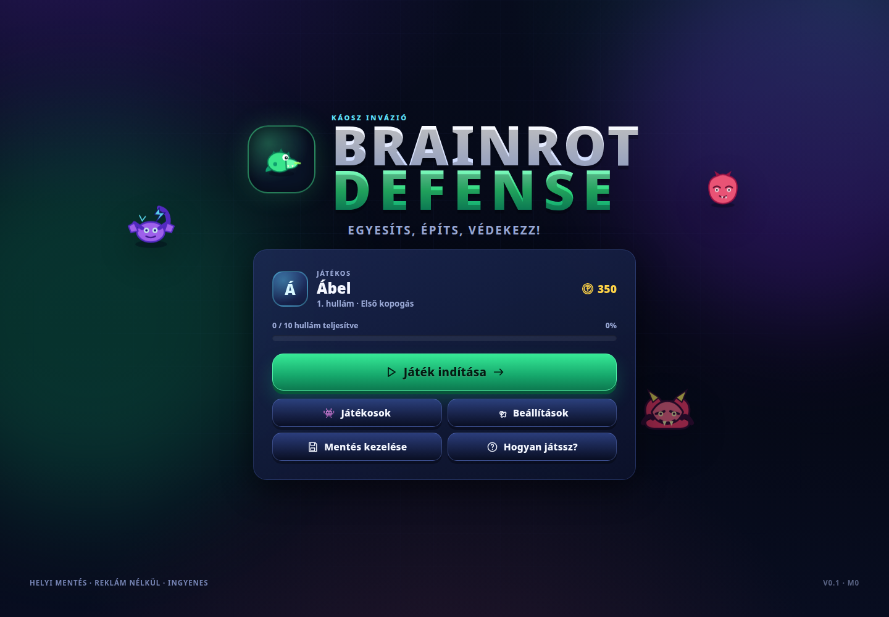
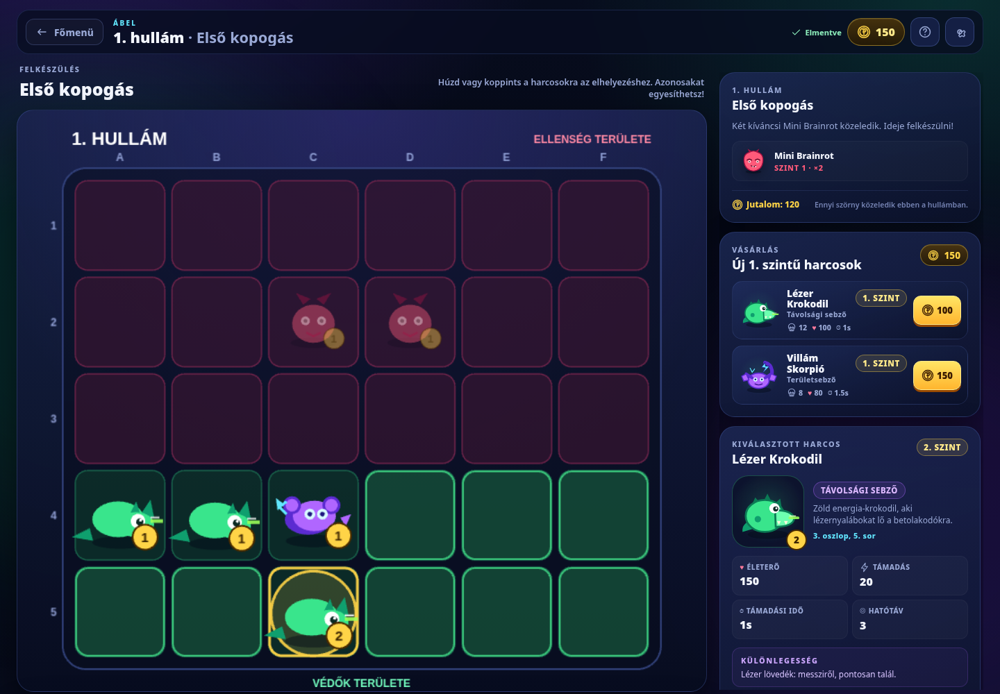
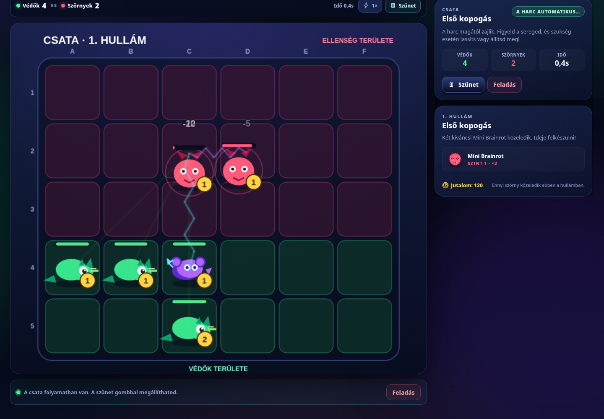
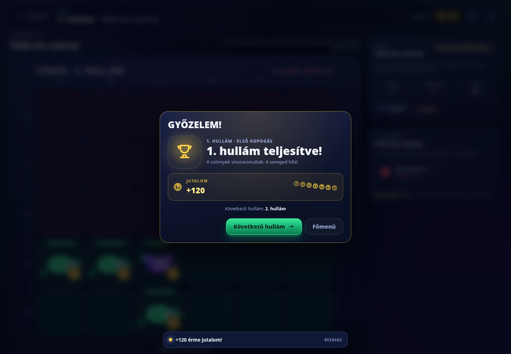

# Brainrot Defense: Káosz Invázió

Egy színes, magyar nyelvű **merge-védekező játék** böngészőre, gyerekeknek (kb. 6–10 éves) és
stratégiát kedvelő felnőtteknek. Vásárolj fantáziaharcosokat, húzd őket a csatatérre, egyesítsd
az azonosakat, majd indíts automatikus csatát a betolakodó szörnyek ellen.

- Ingyenes, reklám nélküli, offline-first.
- Nincs fiók, nincs backend, nincs mikrotransaction.
- Három helyi játékosprofil, automatikus mentés IndexedDB-be.
- 20 adatvezérelt hullám, köztük a **Mega Brainrot Gorilla** (10.) és Ábel saját főellensége, a **Zöld Méreg Sólyom** (20.).
- Kétdimenziós fejlődés: **evolúciós rang 1–10** egyesítésből és **karakterszint 1–100**
  tapasztalati pontból.
- Harcos eladása megerősítéssel, rangalapú visszatérítéssel; teljes pályán is felszabadítható hely.
- M3.4 egyensúly: fokozatos 20 hullámos gazdaság, erősebb 10. és 20. főellenség, 35%-os replay jutalom.
- M3.4.2 early curve: a 3–5., 7., 11. és 17. hullám célzott erősítése; a kezdő sereg már a 4. hullámnál fejlesztést igényel.
- M3.6: Normál / Nehéz nehézségi módok, profilanként mentett beállítással; a Nehéz mód +40% ellenség HP és +20% támadás; 18–19. hullám finomhangolása.
- M3.7: vereségért 50 vigaszdíj és hullámonként legfeljebb 3×20% harci TP; perzisztens vereség-XP számláló.
- Egérrel, érintéssel és billentyűzettel is játszható.
- A játéklogika teljesen független a Phaser rendereléstől és a React UI-tól.

## Képernyőképek

| Főmenü                               | Felkészülés                                      |
| ------------------------------------ | ------------------------------------------------ |
|  |  |

| Csata                                 | Győzelem                                 |
| ------------------------------------- | ---------------------------------------- |
|  |  |

Mobilnézet: [docs/screenshots/mobile.png](docs/screenshots/mobile.png)

## Játékmenet

1. A játékos **350 érmével** és három kezdőharcossal indul.
2. A felkészülési szakaszban nincs időkorlát. Lehet vásárolni, rendezkedni, egyesíteni és
   eladni. Teljes pályán a kiválasztott harcos eladása szabadít fel helyet.
3. Két **azonos típusú és rangú** harcos egy magasabb rangú harcossá egyesíthető. Az egyesítés
   a két harcos tapasztalati pontját is összeadja; a szintek nem kell hogy megegyezzenek.
4. A **HARCOLJ!** gombra kattintva elindul a determinisztikus, automatikus csata.
5. Győzelem esetén a hullám érmejutalma begyűjthető, a résztvevő harcosok tapasztalati pontot
   kapnak, és nyílik a következő hullám. A harcosok szintje a tapasztalatból számolódik.
6. Vereség esetén a sereg **nem tűnik el**. Ingyen újrapróbálható, és apró vigasztaló érmék
   segítik a továbbjutást (20 érme/vereség), így nem alakulhat ki gazdasági zsákutca.
7. A haladás minden fontos művelet után automatikusan mentődik. A böngésző bármikor bezárható.
8. A korábbi M0.1 mentések automatikusan migrálódnak: a régi `level` mező az új `mergeRank`
   érték lesz, a tapasztalat 0-ról indul, minden más előrehaladás megmarad.

A részletes szabályokat lásd: [docs/GAMEPLAY_RULES.md](docs/GAMEPLAY_RULES.md).

## Fejlesztői gyorsindítás

Követelmények: **Node.js 24** (Vite 7 miatt minimum 20.19), npm.

```bash
npm install
npm run dev
```

A fejlesztői szerver alapértelmezésben a `http://localhost:5173` címen fut.

### Parancsok

| Parancs                | Leírás                                            |
| ---------------------- | ------------------------------------------------- |
| `npm run dev`          | Vite fejlesztői szerver                           |
| `npm run build`        | TypeScript-ellenőrzés + produkciós build (SW-vel) |
| `npm run verify:build` | Build assetutak és SW-precache ellenőrzése        |
| `npm run preview`      | A `dist/` produkciós előnézete                    |
| `npm run test`         | Vitest unit- és integrációs tesztek               |
| `npm run test:watch`   | Tesztek figyelő módban                            |
| `npm run test:e2e`     | Build + Playwright böngészőtesztek                |
| `npm run lint`         | ESLint                                            |
| `npm run typecheck`    | `tsc --noEmit`                                    |
| `npm run format`       | Prettier formázás                                 |
| `npm run format:check` | Prettier ellenőrzés                               |

Az E2E tesztek először produkciós buildet készítenek, majd a `vite preview` szervert használják.
Playwright böngésző telepítése szükség esetén:

```bash
npx playwright install chromium
```

## Architektúra

```text
src/
  app/            Alkalmazásvezérlő, React belépési pont, nézetek
  components/     React UI (menük, bolt, felkészülés, modálok)
  game/
    domain/       Tiszta domainmodellek, karakterek, ellenségek, hullámok, gazdaság,
                  tapasztalati görbe és szintszámítás (progression.ts)
    commands/     Immutábilis állapotátmenetek (vásárlás, mozgatás, egyesítés, jutalom, XP)
    simulation/   Determinisztikus, fix lépésközű csataszimuláció
    rendering/    Phaser jelenet és rajzolás (csak megjelenítés)
  persistence/    IndexedDB, séma, validáció, import/export
  localization/   Externalizált magyar szövegek
  audio/          Web Audio alapú, generált hangeffektek
  styles/         Reszponzív, akadálymentes CSS
tests/
  unit/           Domain-, combat- és perzisztenciatesztek
  integration/    Teljes 20 hullámos végigjátszás, mentés-visszatöltés
  e2e/            Playwright böngészőtesztek (desktop + mobil)
```

Az irányított függőségek: `domain ← commands ← app/controller`; a `simulation` csak a domainre
támaszkodik; a `rendering` és a React UI a vezérlőn keresztül olvassa az állapotot. A játék
egyetlen autoritatív állapotmodellje a `GameController` birtokában lévő `PlayerProfile` és az
aktuális `BattleSession`.

Részletek: [docs/ARCHITECTURE.md](docs/ARCHITECTURE.md).

## Mentés

- IndexedDB adatbázis: `brainrot-defense`, `profiles` és `meta` object store-ok.
- Verziózott séma (`schemaVersion: 4`), szigorú validáció, FNV-1a checksum.
- Az M0.1 `schemaVersion: 1`, valamint a korábbi `schemaVersion: 2` és `3` mentések betöltéskor/importkor tiszta migrációval v4-re váltanak.
  A régi rekord biztonsági másolata és egy v4 árnyékmásolat a `meta` store-ban marad; a migráció
  nem foglal el egyetlen játékosprofil-helyet sem. Egy régi lap elavult v1 írását a v4
  árnyékmásolat védi ki.
- Profilonként egy atomi rekordfrissítés; megszakadt írás nem hoz létre félkész mentést.
- Az autosave-ek egy szerializált, koaleszkált írási sorban futnak. A legfrissebb állapot
  felülírja a még nem elindult korábbi pillanatképeket, így nincs korlátlan írási torlódás.
- Import-, törlés- és profilváltási műveletek írási barrierként viselkednek. Egy megerősített
  import nem írható felül régi autosave-ekkel, és egy törölt profil nem támad fel a sorból.
- A profilokhoz generációs azonosító tartozik; a profil életciklusát átlépő elavult írások
  eldobódnak. A profil létrehozása/importja és az aktív profil metaadatinak írása egy
  IndexedDB-tranzakcióban történik.
- Legfeljebb három helyi profil. Alapértelmezett profil: **Ábel**.
- Automatikus mentés vásárlás, egyesítés, mozgatás, hullámjutalom, beállítás és tutorial után.
- Csata közben a rendszer az utolsó stabil felkészülési állapotot őrzi meg; bezárás után a
  csata újraindítható. A csata közbeni sebesség- és beállításváltozások mentődnek, de a
  harci egységek/eredmény csak a csata lezárása után kerül a profilba.
- Egy profil egyszerre egy lapon szerkeszthető. A Web Locks API-val a második lap érthető
  hibaüzenetet kap ahelyett, hogy csendben felülírná az első lap haladását.
- JSON export/import, import előtti megerősítéssel. Hibás import nem írja felül a meglévő mentést.
- Érvényes importált profil minden támogatott játékművelet után érvényes marad. Az érme- és
  karakter-ID túlcsordulás explicit hibát ad, nem hoz létre menthetetlen állapotot.
- Sérült mentést a játék nem töröl csendben; hibaüzenetet mutat, és másik profil/import választható.
- A böngésző tartós tárhelye (`navigator.storage.persist()`) opcionálisan kérhető, de nem garantált.

Részletek: [docs/SAVE_SCHEMA.md](docs/SAVE_SCHEMA.md).

## Offline működés (PWA)

A produkciós build a `vite.config.ts` build-pluginjével generálja a `dist/sw.js` service
workert. A generált fájl a tényleges, hash-elt Vite asseteket tartalmazó, build-verziózott
precache listát kap:

- a teljes app shell (HTML, JS, CSS, manifest, ikonok, CNAME) előre cache-elődik;
- a cache neve a build tartalmából számított hash-t tartalmaz;
- a telepítés egy külön staging cache-be tölt, hiba esetén nem aktivál félkész cache-t;
- aktiváláskor a régi, azonos prefixű cache-ek törlődnek;
- navigáció network-first, cache-fallback; az essential assetek cache-first módon jönnek a
  precache-ből, offline nincs hálózati függőségük.

A Playwright tesztek külön ellenőrzik, hogy egy friss első látogatás után, további online
újratöltés nélkül is működik az offline újranyitás, és hogy a mentett haladás megmarad.
A service worker csak produkciós módban regisztrál. A mentési adatok IndexedDB-ben vannak, így
az appfrissítés nem írja felül őket; a sémaverzió és checksum védi a betöltést.

## GitHub Pages telepítés

A kiválasztott production cél a **custom-domain root**: `https://brainrot.herczeg.cc/`.
A workflow explicit `VITE_BASE_PATH=/` értékkel buildel, a `public/CNAME` a custom domainhez
tartozik. Projekt-aloldalra váltáskor a base pathot és a CNAME-t is át kell állítani.

A `.github/workflows/deploy.yml` minden `main` pushnál és manuális `workflow_dispatch` esetén
futtatja a lintet, típusellenőrzést, unit/integrációs teszteket, production buildet,
asset-path/precache ellenőrzést és E2E teszteket. Pull requesten csak az ellenőrzések futnak.

A deploy job szándékosan csak akkor fut, ha a repository Actions-változója
`PAGES_DEPLOY_ENABLED=true`. Ez megakadályozza, hogy a custom domain/DNS beállítása előtt
véletlenül éles deploy történjen. **A custom domain és a Pages beállítás ebben a repository
állapotában nincs konfigurálva, és nem történt push/deploy.** A pontos owner-lépések:
[docs/DEPLOYMENT.md](docs/DEPLOYMENT.md).

## Tesztelés

- **Unit/integrációs:** 362 teszt, 45 fájlban. merge/rang-szabályok, eladás és visszatérítés, M3.4 jutalomtábla és boss-nehézség, M3.4.2 early-curve benchmarkok, M3.6 difficulty scaling, M3.7 vereségjutalom és v4-mentésmigráció, XP-küszöbök minden
  határon, XP-összeadás és sapka, első győzelmi és csökkentett ismételt XP, halott és nem
  résztvevő harcosok kizárása, gazdaság, statisztikák, rács, hullámok, targeting, range,
  cooldown, páncél, láncvillám, halál, győzelem/vereség, determinizmus, 1×/2× sebesség,
  frame-rate függetlenség, IndexedDB round-trip, szigorú v1→v2 migráció, hiányzó shadow
  biztonságos helyreállítása, törlési tombstone, elavult v1 írás kivédése, checksum, korrupt
  mentés, import validáció és invariánsok, profilizoláció, írási sor/koaleszálás,
  import/törlés versenyhelyzetek, boundary- és overflow-tesztek, aktív profil metaadat
  hibakezelés, zárolás tulajdonjog, késleltetett/hibás csatajutalom-mentés, több-lapos
  védelem, teljes 20 hullámos végigjátszás, mérgezés, forgó pajzs, távolsági pajzstörés, földrengéses fagyasztás.
- **Böngésző:** 113 sikeres teszt + 11 kihagyott (eszközspecifikus desktop/mobil tesztek),
  Chromium desktopon és mobil emulációban, valódi IndexedDB-vel: menü, játék
  indítás, Normál/Nehéz választás és perzisztencia, meglévő wave-20 mentés Nehéz Falconja, egykattintásos vásárlás, teljes pályás eladás és cserevásárlás, szövegkijelölés
  elleni védelem, egyesítés egérrel és akadálymentes panellel, eltérő XP-szintű harcosok
  egyesítése, rang/szint/XP megjelenítés, győzelmi XP és szintlépés, reload utáni
  XP-megmaradás, M0.1 mentés importja, áthelyezés, csata, pause/resume, 2× sebesség, győzelem,
  vereség, jutalom, export/import, profil létrehozás/törlés, boundary import, nagy
  autosave-backlog utáni import/törlés, hang-szinkron, surrender lifecycle, több-lapos
  védelem, sikertelen azonos ID-s import utáni zárolás, régi tab melletti migráció és offline
  újranyitás, törölt profil feltámadásának kivédése, friss első látogatás utáni offline
  újranyitás. A mobil futás Chromium-emuláció, nem valódi iOS Safari.
- Determinisztikus tesztek fix seeddel és fix lépésközzel; nincs kép-összehasonlításos
  törékeny teszt.

## Ismert korlátok (M1.1)

- A csatatér Phaser canvas; a nem-drag interakciót és a billentyűzetes elhelyezést külön DOM
  panel biztosítja. A canvas tartalma önmagában nem olvasható képernyőolvasóval.
- A hangok szintetizált placeholderek, nincs zene.
- A grafikák programozott, eredeti placeholderek; nincs még sprite atlas vagy asset pipeline.
- A Phaser miatt a JS bundle ~1.58 MB (gzip ~441 kB). Később kódrészletekre bontható.
- Új karaktergrafika még nincs; a rangot és szintet a meglévő programozott placeholderek
  badge-ei, a felkészülési inspector és a csataeredmény jeleníti meg. Az M1.2 hozhat
  sprite/asset pipeline-t.
- Az ismételt hullám csökkentett XP-je implementált és tesztelt, de a jelenlegi UI még nem
  kínál hullámválasztót, ezért játék közben csak egy későbbi mérföldköben válik elérhetővé.
- Az automatikus több-lapos védelem a Web Locks API-ra épül; ahol ez nem elérhető, ott a
  játék a korábbi single-tab viselkedésre esik vissza.
- **M3.4 egyensúly:** az új gazdaság és ellenségszintek mind a nyolc vizsgált stratégiánál
  teljesítik a 20 hullámot; a kezdő és kazsuális stratégiák a 10. és 20. hullámban szoros
  csatát vívnak. A részletes előtte/utána táblázat és szimulációs eredmények:
  [docs/BALANCE_M3.4.md](docs/BALANCE_M3.4.md). Valós játékteszt továbbra is szükséges, különösen
  Ábel szokásos játékstílusával.
- Automatizált böngészőteszt Chromiumon (desktop + mobil emuláció) fut. Firefox és Safari
  manuális ellenőrzést igényel; a kód szabványos Pointer Events/IndexedDB/Web Locks API-kra épül.
- A custom domain beállítása és az éles deploy a tulajdonos jóváhagyását igényli.

## Következő mérföldkövek

- **M1.2:** sprite/asset pipeline, animált hangeffektek, rang szerinti karaktergrafika.
- **M2:** további karakterek, upgrade-ek, passzív képességek, hullámválasztó.
- **M3:** export/import minden profilra, további sémamigrációk.
- **M4:** akadálymentességi audit, Firefox/Safari CI, teljesítményprofilozás, kódrészletezés.

## Jogosultság és assetek

A kód MIT licenc alatt áll (lásd [LICENSE](LICENSE)). A játékhoz készült programozott
vektor- és hangassetek eredeti placeholderek, harmadik fél jogait nem sértik. Részletek:
[docs/ASSETS.md](docs/ASSETS.md).
